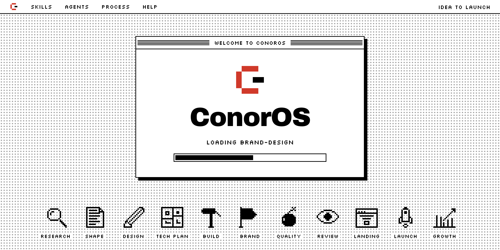
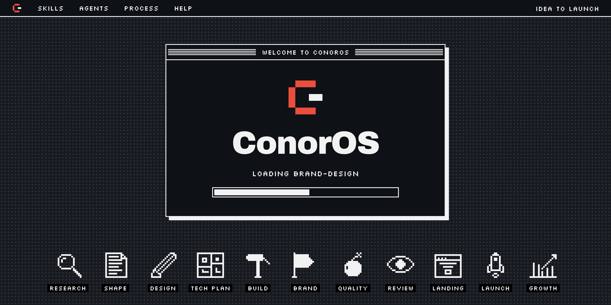

<p align="center">
  
  
</p>

<p align="center">Claude skills and agents that take a product from idea to launch.</p>

<p align="center">
  <a href="#skills">Skills</a> ·
  <a href="#agents">Agents</a> ·
  <a href="#setup">Setup</a>
</p>

<p align="center">
  
  
</p>

My Claude Code setup: the skills, agents, and global rules that follow me into every project. They cover how I take a product from idea to launch (research, shaping, design, build, brand, and growth) and hand the work to four agent roles.

I publish it from my private copy every week, minus anything too specific to me (my products, my accounts, the details of past projects). Fork it and make it yours. I'm not taking issues or pull requests.

## Skills

### Research and shaping

- **[zero-to-one](skills/zero-to-one/SKILL.md)**: Runs a product in two modes, Personal (built for you first) and Go live (taken public), calling the right skill at each step and holding a gate between them.
- **[product-research](skills/product-research/SKILL.md)**: Landscape research for a new idea: parallel lanes, each graded against criteria written before it ran, then one synthesis.
- **[product-shaping](skills/product-shaping/SKILL.md)**: Frame the problem, research it, shape the solution, then a cold read (paraphrase, premortem, design readiness).
- **[product-doc](skills/product-doc/SKILL.md)**: Writes the doc: the questions to answer first, the sections, and how to fill in Solution Details.

### Design

- **[design-shaping](skills/design-shaping/SKILL.md)**: The design step end to end: journey, competitive look, wildly different explorations, convergence, hi-fi, Solution Details.
- **[wireframe-explorations](skills/wireframe-explorations/SKILL.md)**: Three to five lo-fi options per surface, ugly on purpose, with real data.
- **[hifi-design](skills/hifi-design/SKILL.md)**: One hi-fi pass per surface on the Paper canvas, from DESIGN.md and tokens to the build handoff.
- **[visual-assets](skills/visual-assets/SKILL.md)**: Turns a sketchy decorative visual (hero, backdrop, illustration) into a striking one, scored by blind critics.
- **[motion-design](skills/motion-design/SKILL.md)**: Decides what should move at all, then specs and prototypes it into DESIGN.md.
- **[explain-interface](skills/explain-interface/SKILL.md)**: Takes apart a site or effect someone shared: real CSS, tokens, and motion, and what transfers to ours.
- **[design-sources](skills/design-sources/SKILL.md)**: The one shared list of galleries, fonts, icons, components, and craft writing, each with a taste verdict.

### Build and quality

- **[tech-planning](skills/tech-planning/SKILL.md)**: Three biased approaches, a plan with decision records, a five-seat critic panel, then the epic.
- **[build](skills/build/SKILL.md)**: Runs a milestone as a lead that never writes code: a fresh implementer and an agent review per issue.
- **[pr-review](skills/pr-review/SKILL.md)**: Fresh-context reviewers who never see the PR body, a validator per serious finding, then a verdict.
- **[break-it](skills/break-it/SKILL.md)**: Drives every surface with the worst case (0, 1, 1,000, slow, failed, pressed twice) and reports before fixing.
- **[untangle](skills/untangle/SKILL.md)**: For a messy repo: finds the hidden links and surplus pieces, logs decisions, fixes on one PR. User-invoked only.

### Brand, launch, and growth

- **[brand-design](skills/brand-design/SKILL.md)**: A brand idea from the product's own subject, a wide round of directions, foundation sprints, blind critics, then the token swap. Also holds what a repo README needs ([reference](skills/brand-design/references/readme.md)): examples, GitHub mechanics, a lint script.
- **[product-naming](skills/product-naming/SKILL.md)**: Hundreds of candidates, availability checked by script, down to a name and a backup.
- **[landing-page](skills/landing-page/SKILL.md)**: The buyer's own words, the argument before markup, the product shown as itself, a gate script and blind critics.
- **[launch-kit](skills/launch-kit/SKILL.md)**: One story and one render, then every clip, still, gallery, and post cut from it.
- **[growth-strategy](skills/growth-strategy/SKILL.md)**: Tears down three to five rivals from public evidence and commits to two or three techniques with metrics.

### Writing and notes

- **[writing-style](skills/writing-style/SKILL.md)**: My voice, applied to anything written for me, with a register per format ([essays](skills/writing-style/references/essays.md), [Slack](skills/writing-style/references/slack.md)).
- **[research-notes](skills/research-notes/SKILL.md)**: Messy interview notes into short, insight-first notes. What happened.
- **[call-debrief](skills/call-debrief/SKILL.md)**: A back-and-forth on one call, then a short Debrief. What it means.
- **[meeting-notes](skills/meeting-notes/SKILL.md)**: Internal meeting notes and recaps.
- **[authoring-skills](skills/authoring-skills/SKILL.md)**: House style for writing skills, the personal-vs-work split, and the [model routing legend](skills/authoring-skills/references/model-routing.md).

### Judges

Third-party skills our process skills call at a named step, never ad hoc. They aren't in this repo: [`vendor.json`](vendor.json) pins each one to an upstream commit, and the sync script in Setup installs it. Our only edits are frontmatter overrides in the manifest.

| Skill | Author | What it judges | Called by |
|---|---|---|---|
| [better-ui](https://github.com/jakubkrehel/skills/tree/main/skills/better-ui) | Jakub Krehel | Polish with exact values: surfaces, icons, motion | build, landing-page, zero-to-one |
| [better-accessibility](https://github.com/jakubkrehel/skills/tree/main/skills/better-accessibility) | Jakub Krehel | Keyboard, focus, ARIA, and zoom against WCAG 2.2 | build |
| [impeccable](https://github.com/pbakaus/impeccable) | Paul Bakaus | Design critique with detectors for AI-default looks | hifi-design, visual-assets, landing-page, build |
| [review-animations](https://github.com/emilkowalski/skills/tree/main/skills/review-animations) | Emil Kowalski | Motion code against ten standards | motion-design, hifi-design, launch-kit |
| [apple-design](https://github.com/emilkowalski/skills/tree/main/skills/apple-design) | Emil Kowalski | Springs, gestures, momentum, materials | Parked for the first gesture-heavy product |
| [mobile-native](https://github.com/emilkowalski/skills/tree/main/skills/mobile-native) | Emil Kowalski | What makes a web app feel installed on a phone | Parked for the first phone-first product |

## Agents

The roles skills hand work to. Each is pinned to a model and effort from the routing legend, so no skill names a model.

| Role | Model | Used for |
|---|---|---|
| [researcher](agents/researcher.md) | Fable 5.2, medium | One research lane to a sourced report |
| [planner](agents/planner.md) | Fable 5.2, high | A tech plan that compares approaches and settles one |
| [critic](agents/critic.md) | Opus 5.5, medium | Blind scoring of a screenshot or doc against a rubric |
| [worker](agents/worker.md) | Opus 5.5, high | Any other bounded task |

Also registered outside this repo: the `a11y` MCP server for contrast checks on DESIGN.md tokens.

## Setup

Clone the repo to any folder, then symlink it into `~/.claude` so everything loads in every project:

```bash
REPO=~/conor-os
git clone https://github.com/cdeweyx/conor-os.git $REPO
ln -s $REPO/skills ~/.claude/skills
ln -s $REPO/global/CLAUDE.md ~/.claude/CLAUDE.md
for f in $REPO/agents/*.md; do ln -s "$f" ~/.claude/agents/; done
claude mcp add a11y --scope user -- npx -y a11y-mcp-server
python3 -I $REPO/skills/authoring-skills/scripts/vendor-sync.py
```

- `global/CLAUDE.md` is the global rules file.
- Run the sync script again after every pull. A pull that changes `vendor.json` changes the pins, and the script prints what moved.
- Edits to a `SKILL.md` go live in open sessions once main is pulled.

## Credits

Installed or adapted under their licenses:
- [jakubkrehel/skills](https://github.com/jakubkrehel/skills) (MIT): better-ui, better-accessibility, explain-interface.
- [emilkowalski/skills](https://github.com/emilkowalski/skills) (MIT): review-animations, apple-design, mobile-native, and break-it's starting point.
- [pbakaus/impeccable](https://github.com/pbakaus/impeccable) (Apache 2.0): impeccable.
- [caldoai/skills](https://github.com/caldoai/skills) and [LordGhostX/agents-skills](https://github.com/LordGhostX/agents-skills) (MIT): untangle.
- marketingskills (MIT): growth-strategy's [teardown script](skills/growth-strategy/scripts/teardown.mjs).

## License

MIT, in [`LICENSE`](LICENSE). Third-party work keeps its own license, listed in [`THIRD_PARTY_NOTICES.md`](THIRD_PARTY_NOTICES.md).
